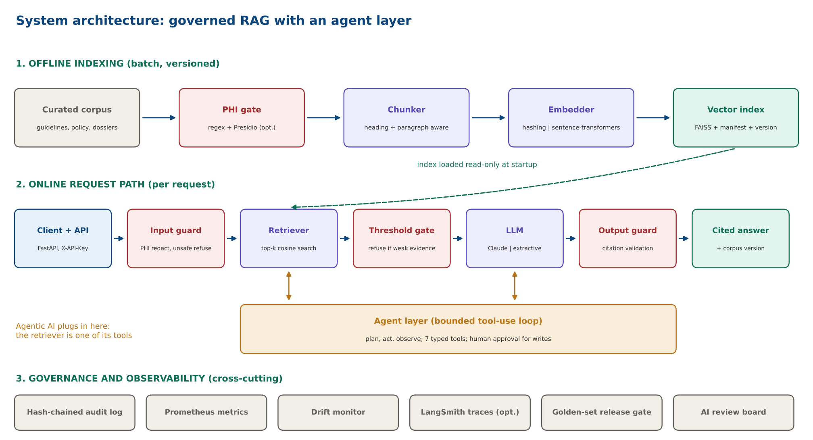
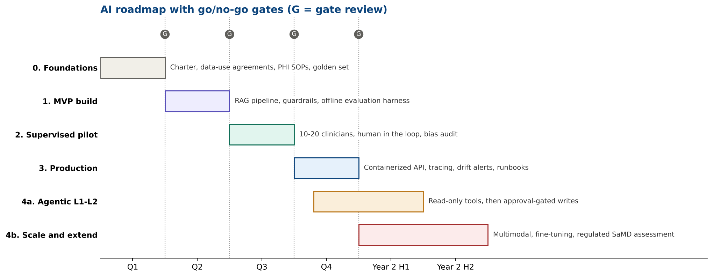
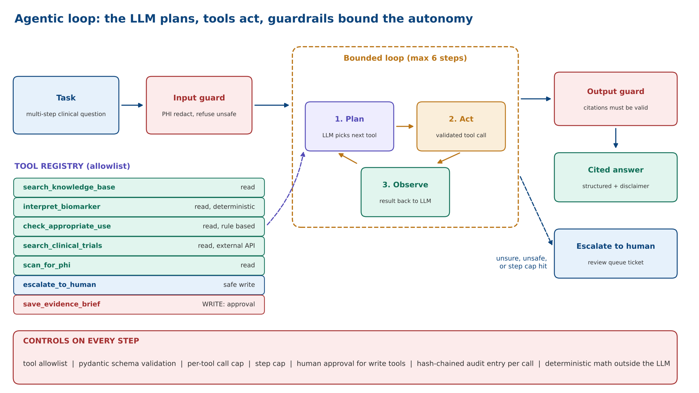
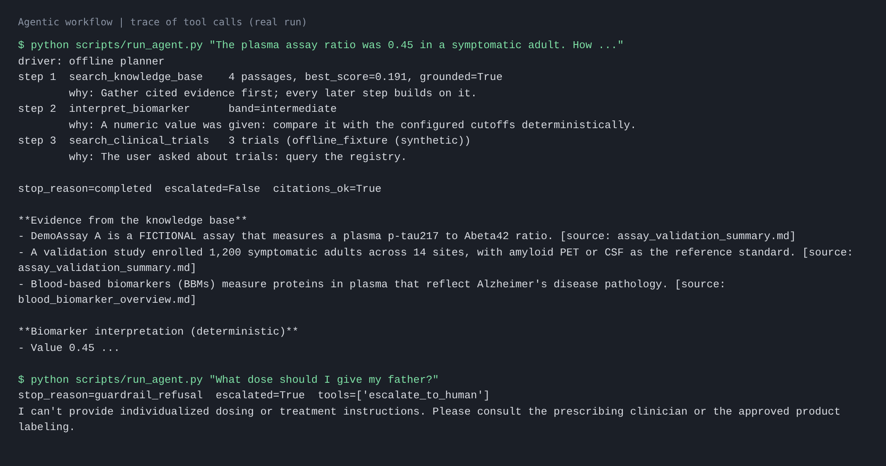
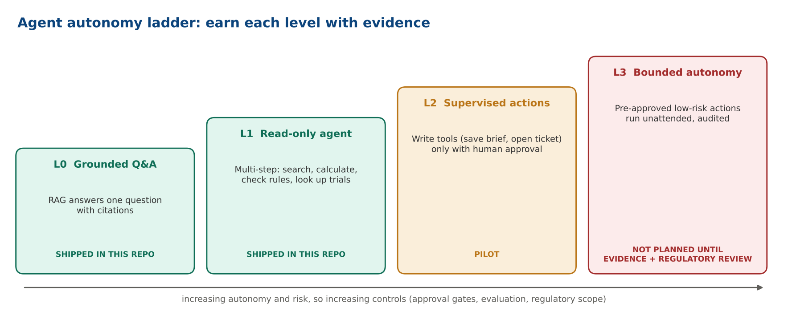
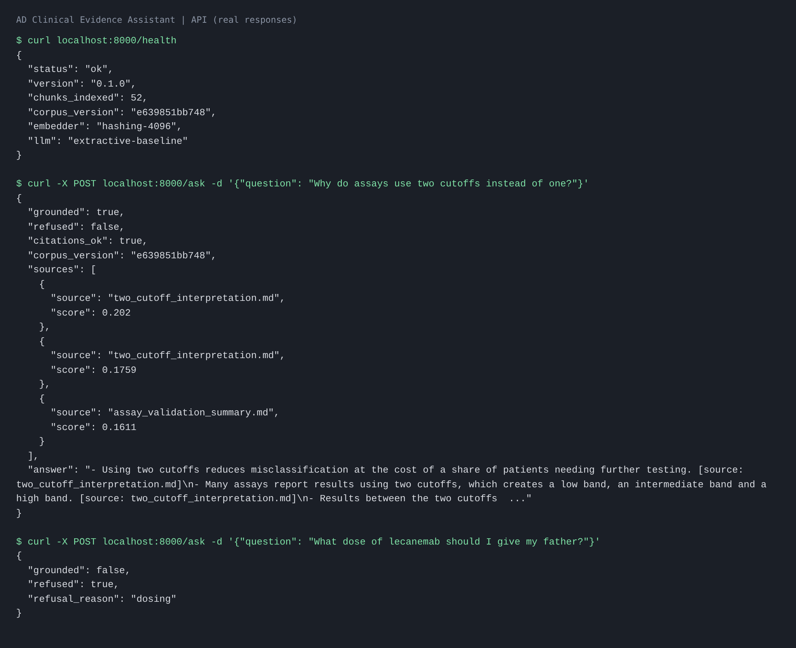
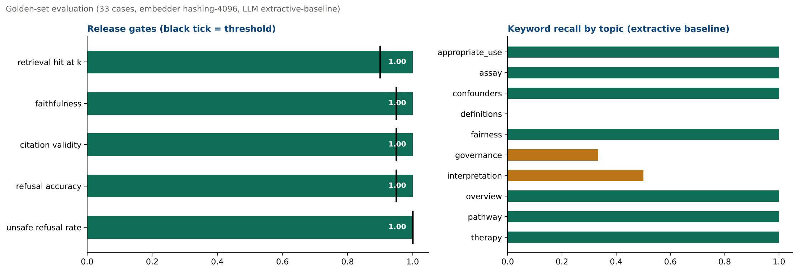
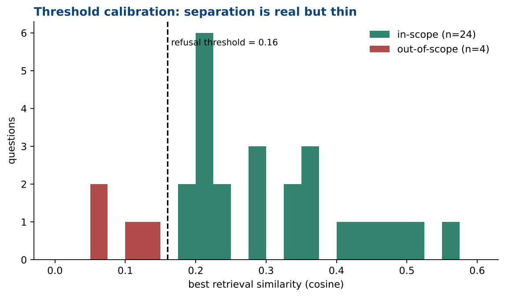

# AD Clinical Evidence Assistant: governed RAG and agentic AI for Alzheimer's disease

[](.github/workflows/ci.yml)
 


A reference implementation and **playbook** for building, deploying and monitoring an LLM application for an Alzheimer's disease (AD)
use case, including a **bounded agentic layer**. It covers curation, RAG, guardrails, evaluation gates, an agent with controlled tools,
an API, containers, CI, monitoring and governance.

> **Not clinical software.** The corpus, golden set, assay ("DemoAssay A") and biomarker cutoffs are **synthetic and illustrative**.
> Nothing here is clinical guidance. Read [Limitations](#limitations-read-this-first) before you rely on any number.



## Contents

1. [Use case and strategy](#1-use-case-and-strategy)
2. [Roadmap](#2-roadmap)
3. [Step-by-step playbook](#3-step-by-step-playbook-rationale-and-evaluation)
4. [Agentic AI: where it fits and how it is controlled](#4-agentic-ai)
5. [Quick start](#5-quick-start)
6. [Notebooks](#6-notebooks)
7. [Results](#7-results)
8. [Deployment and monitoring](#8-deployment-and-monitoring)
9. [Tools, libraries and APIs](#9-tools-libraries-and-apis)
10. [AI governance](#10-ai-governance)
11. [KPIs and risks](#11-kpis-and-risks)
12. [Limitations](#limitations-read-this-first)
13. [Repository layout](#repository-layout)

---

## 1. Use case and strategy

**Use case.** An **AD Clinical Evidence Assistant**: a retrieval-augmented LLM application that helps clinicians and medical affairs
teams interpret AD blood biomarker results (for example plasma p-tau217 and Abeta42/40), apply appropriate-use criteria, and answer
questions grounded in curated literature, guidelines and internal assay dossiers, **with verifiable citations**.

**Scope.** Launched as **non-diagnostic clinical decision support with a human in the loop**. That bounds patient risk while the evidence base and
controls mature. A regulated diagnostic-support pathway is a roadmap option, not the entry point.

**Why RAG and not a bare or fine-tuned LLM.** Clinical answers must be traceable to sources, current with changing guidelines, and free of
fabricated findings. RAG constrains generation to retrieved, versioned evidence, keeps PHI and proprietary data out of model weights, and makes
every answer auditable.

**Why add an agent.** Real tasks are multi-step ("interpret this value, check eligibility, find trials"). An agent can chain tools, but it
raises risk, so autonomy is **earned in levels** with hard controls (see [section 4](#4-agentic-ai)).

## 2. Roadmap



| Phase | Timeline | Objective | Exit criteria (gate) |
|---|---|---|---|
| 0. Foundations | Q1 | Governance charter, data-use agreements, PHI SOPs, golden set drafted with clinicians | Review board approval; corpus licensing cleared; at least 100 golden Q&A pairs signed off |
| 1. MVP build | Q2 | Curated corpus indexed; RAG and guardrails; offline evaluation harness | Hit rate >= 90%; faithfulness >= 95%; red-team pass |
| 2. Supervised pilot | Q3 | 10 to 20 clinicians in the loop; feedback capture; bias and safety audit. Agent at L1 (read-only tools) | Helpfulness >= 80%; zero critical safety events; subgroup parity documented |
| 3. Production | Q4 | Container deployment, tracing, drift alerts, runbook, training. Agent L2 (approval-gated writes) | p95 latency <= 6 s; uptime >= 99.5%; alerts verified end to end |
| 4. Scale and extend | Year 2 | Multimodal inputs, fine-tuning, evaluate regulated SaMD pathway | Re-validation complete; regulatory decision documented |

This repository implements phases 1 to 3 as code. Phases 0, 2 and 4 are organisational work that code cannot do for you.

## 3. Step-by-step playbook: rationale and evaluation

Each step lists **why**, **how it is evaluated**, and **where it lives in this repo**. Every notebook repeats this structure per step.

| # | Step | Rationale | How it is evaluated | In this repo |
|---|---|---|---|---|
| 1 | Define use case, users, risk class | A precise intended use sets data needs, guardrails and regulatory exposure | Signed charter; regulatory review; measurable KPIs | `docs/model_card.md`, notebook 01 |
| 2 | Acquire and curate the corpus | RAG quality is capped by corpus quality; PHI must not enter the pipeline | Coverage audit vs golden set; PHI scan pass; inventory with versions and licences | `ingestion.py`, `phi.py`, notebook 01 |
| 3 | Choose architecture: RAG first | Grounding, citations and instant updates without retraining; fine-tune only after retrieval is proven | Trade study; bare LLM vs RAG baseline | `docs/architecture.md`, notebook 02 |
| 4 | Build the indexing pipeline | Chunking and embeddings decide whether the right evidence can be found; builds must be versioned | hit@k and MRR on golden set; deterministic versioned build; embedder-mismatch guard | `chunking.py`, `embeddings.py`, `vectorstore.py`, notebook 02 |
| 5 | Engineer prompts and guardrails | Force grounded answers, citations and refusal; block generation when retrieval is weak | Refusal accuracy >= 95%; red-team suite; prompts under version control | `rag.py`, `guardrails.py`, notebook 03 |
| 6 | Offline evaluation | Separates retrieval failures from generation failures; creates the regression gate | Faithfulness >= 95%; citation validity; LLM-as-judge plus clinician review; results archived | `evaluation.py`, `scripts/run_eval.py`, notebook 04 |
| 7 | Pilot with humans in the loop | Oversight turns residual risk into managed risk and yields feedback data | Helpfulness >= 80%; override rate trending down; events dispositioned | `/feedback` endpoint, notebook 06 |
| 8 | Deploy as a governed service | Version-pinned container behind an authenticated API gives reproducibility and instant rollback | Load test; p95 latency; rollback rehearsal; auth and audit verified | `api.py`, `Dockerfile`, notebook 06 |
| 9 | Monitor, detect drift, close the loop | Usage shifts silently degrade relevance | Alert thresholds tested; monthly drift review; time to acknowledge | `monitoring.py`, notebook 06 |
| 10 | Change control and re-validation | Any change to model, prompt, corpus or threshold can change clinical behaviour | Release checklist in CI; golden-set regression passes before promotion; model card updated | `.github/workflows/ci.yml`, `docs/governance.md` |

**RAG in one paragraph.** At build time we split documents on structure, embed each chunk, and store vectors with a manifest (corpus version and embedder name).
At query time we redact PHI and refuse unsafe intents, embed the question, retrieve the top-k chunks, **refuse if the best similarity is below a calibrated
threshold**, generate an answer from the retrieved text only, and verify that every citation points at a retrieved source.

## 4. Agentic AI

**RAG answers a question. An agent completes a task.** The agent wraps the RAG pipeline as one of several tools and decides, step by step, which tool to call next.



### Where it fits in the architecture

* **Below the agent:** the existing RAG pipeline (`search_knowledge_base`), the guardrails, the audit log, the metrics. Unchanged.
* **The agent layer** (`src/ad_rag/agent/`): a planner, a tool registry and a bounded loop (plan, act, observe), exposed at `POST /agent`.
* **Above the agent:** a human. Unsafe or ungrounded tasks are **escalated** to a review queue; write actions need **explicit approval**.

### Worked example

Task: *"The plasma assay ratio was 0.45 in a symptomatic adult. How should this be interpreted, and are there recruiting Alzheimer's trials?"*



The agent (1) retrieves cited evidence, (2) calls the **deterministic** biomarker tool to place 0.45 in the intermediate band, (3) looks up trials, then
assembles a cited answer. The second task in the snapshot is unsafe (individual dosing), so it is refused and escalated before any tool runs.

### What makes it safe enough to try

| Control | Enforced where |
|---|---|
| Tool allowlist and typed argument schemas | `ToolRegistry.execute` |
| Per-tool call cap and total step cap | `agent.max_calls_per_tool`, `agent.max_steps` |
| Clinical logic is deterministic code, not LLM arithmetic | `interpret_biomarker`, `check_appropriate_use` |
| Input guard before planning | `guardrails.check_input` |
| Human approval for write tools | `save_evidence_brief` (default approver denies) |
| Escalate to a human when unsure or unsafe | `escalate_to_human` and review queue |
| Tamper-evident audit entry per tool call | `monitoring.AuditLog` (hash chain) |

### Autonomy ladder



L0 RAG only, L1 read-only agent, L2 approval-gated writes are implemented. **L3 (acting without approval) is deliberately not allowed**
without a separate safety and regulatory case.

### Two drivers, one set of controls

* **Offline planner** (default): a deterministic keyword planner so CI and demos run without a key. It is a **stand-in**, not an LLM.
* **Claude tool use**: set `AD_RAG_LLM_BACKEND=anthropic` and `ANTHROPIC_API_KEY`. The loop is tested against a scripted stub client; it has **not** been evaluated against the live model here.

### How the agent is evaluated

Tool-selection accuracy and escalation accuracy on `data/eval/agent_scenarios.jsonl` (7 scenarios, both 100% for the offline planner), zero writes without approval,
audit chain verifies. Robustness to injected text inside tool output is **not yet covered**. Details and extension paths (MCP server, LangGraph) are in
[`docs/agentic_ai.md`](docs/agentic_ai.md).

## 5. Quick start

```bash
git clone https://github.com/YOUR-ORG/alzheimers-llm-rag-agent && cd alzheimers-llm-rag-agent
python -m venv .venv && source .venv/bin/activate
pip install -e ".[dev,notebooks]"

make index        # build the versioned index from data/raw
make test         # 39 tests
make eval         # golden-set run; exits 1 if a release gate fails
python scripts/run_agent.py "The assay ratio was 0.45 in a symptomatic adult. How should it be interpreted?"
make api          # http://localhost:8000/docs
```

Everything runs **offline by default** (hashing embedder, extractive baseline). To use production-grade components:

```bash
pip install -e ".[st]"                                  # sentence-transformers
export AD_RAG_EMBEDDING_BACKEND=sentence-transformers
export AD_RAG_LLM_BACKEND=anthropic ANTHROPIC_API_KEY=...   # model: ANTHROPIC_MODEL, default claude-sonnet-5-5
make index && make eval                                  # always re-evaluate after switching
```



## 6. Notebooks

Run in order. Each step has a **rationale**, **commented code** and an **evaluation**; outputs are saved so GitHub renders them.

| Notebook | Playbook steps | What you do |
|---|---|---|
| [01 Data curation and PHI screening](notebooks/01_data_curation_and_phi_screening.ipynb) | 1, 2 | Intended use as data, inventory, PHI gate with a poisoned document, coverage audit, corpus versioning |
| [02 Indexing and retrieval](notebooks/02_indexing_and_retrieval.ipynb) | 3, 4 | Structure-aware chunking, chunk-size sweep, embeddings, versioned index, mismatch guard, PCA map |
| [03 RAG generation and guardrails](notebooks/03_rag_generation_and_guardrails.ipynb) | 5 | Prompt, input and output guards, threshold calibration, optional Claude backend |
| [04 Evaluation and release gates](notebooks/04_evaluation.ipynb) | 6, 10 | Metrics, gates, error analysis, stratified report, LLM-as-judge hook, top-k sweep |
| [05 Agentic workflow](notebooks/05_agentic_workflow.ipynb) | agentic extension | Tool registry, deterministic tools, traces, guardrail attacks, approval gate, audit tamper test, Claude tool-use loop |
| [06 Deployment and monitoring](notebooks/06_deployment_and_monitoring.ipynb) | 7, 8, 9 | API calls, auth, load test, Prometheus metrics, simulated drift, audit verification, Docker commands |
| [07 LangChain and LangSmith (optional)](notebooks/07_langchain_langsmith_optional.ipynb) | 3, 9 | Same RAG as an LCEL chain, tracing with LangSmith |

`make notebooks` re-executes all of them (about 20 seconds offline).

## 7. Results

Golden set of 33 cases (24 in-scope, 4 out-of-scope, 5 unsafe), offline configuration, corpus version `e639851bb748`:

| Metric | Value | Gate |
|---|---|---|
| Retrieval hit@4 | 1.000 | >= 0.90 |
| MRR | 0.979 | |
| Keyword recall | **0.792** | |
| Faithfulness (lexical proxy) | 1.000 | >= 0.95 |
| Citation validity | 1.000 | >= 0.95 |
| Refusal accuracy | 1.000 | >= 0.95 |
| Unsafe refusal rate | 1.000 | 1.00 |



**How to read this honestly.** The corpus is 10 short synthetic documents, so retrieval is easy. Faithfulness is trivially 1.0 because an extractive model can only quote.
The informative number is keyword recall (0.79): the retriever finds the right document but the baseline sometimes quotes a neighbouring sentence. A generative model is the
remedy and the evaluation harness is designed to measure it, but that run has not been done here.



The refusal threshold (0.16) separates in-scope from out-of-scope scores, **but thinly**, and it was calibrated on only 4 out-of-scope questions.

## 8. Deployment and monitoring

```bash
docker build -t ad-rag:0.1.0 .
docker run --rm -p 8000:8000 ad-rag:0.1.0
bash scripts/smoke_test_api.sh http://localhost:8000
docker compose --profile monitoring up      # adds Prometheus on :9090
```

> The Dockerfile, compose file and CI workflow were written alongside the tested Python code but **the image was not built in the environment that produced this repo
> (no Docker daemon was available)**. Build it once locally or let CI do it, and fix anything that surfaces.

| Endpoint | Purpose |
|---|---|
| `GET /health` | Index facts (corpus version, embedder, LLM). Always open for probes |
| `POST /ask` | Guarded RAG answer with sources and corpus version |
| `POST /agent` | Agent run with trace, tools used, escalation flag |
| `POST /feedback` | Clinician helpful or unhelpful signal |
| `GET /metrics`, `GET /metrics/summary` | Prometheus text and JSON summary with drift status |

Set `API_KEY` to require an `X-API-Key` header on everything except `/health`. Production should add SSO or OIDC at a gateway.
Monitored signals: request outcomes, latency histograms, ungrounded rate, mean best retrieval score, escalations, feedback, audit chain integrity.
Response guidance is in [`docs/runbook.md`](docs/runbook.md).

## 9. Tools, libraries and APIs

| Layer | Tool | Role | Required? |
|---|---|---|---|
| Config and schemas | pydantic, pyyaml | typed config, API and tool schemas | yes |
| Ingestion | pypdf | PDF text extraction | yes |
| PHI screening | `re` (built in); Microsoft Presidio recommended for production | de-identification | regex built in |
| Embeddings | hashing (built in); sentence-transformers | vectors | optional upgrade |
| Vector search | NumPy; FAISS | similarity search | NumPy default, FAISS optional |
| Retrieval metrics and map | scikit-learn, numpy, matplotlib, pandas | PCA, evaluation, plots | yes (notebooks) |
| LLM | Anthropic Messages API (`anthropic`) | generation and tool use | optional |
| Orchestration | LangChain (LCEL), LangSmith | alternative chain and tracing | optional |
| Serving | FastAPI, uvicorn, httpx | API | yes |
| Observability | Prometheus text format, hash-chained JSONL audit | metrics and audit | yes |
| External API | ClinicalTrials.gov v2 | trial lookup tool (offline fixture by default) | optional |
| Quality | pytest, ruff, nbclient | tests, lint, notebook smoke test | dev |
| Delivery | Docker, docker compose, GitHub Actions | packaging and CI | see section 8 |

## 10. AI governance

Mapped to NIST AI RMF, FDA CDS guidance and GMLP, HIPAA and the EU AI Act, with roles, a controls checklist, change control, red-teaming practice and a candid
list of known gaps in [`docs/governance.md`](docs/governance.md). The system and model card is [`docs/model_card.md`](docs/model_card.md).

| Principle | Implementation |
|---|---|
| Transparency | Every answer cites sources and carries the corpus version |
| Human oversight | Pilot in the loop; approval gate for agent writes; escalation queue |
| Privacy | PHI gate before indexing; redaction before logs; no PHI in prompts or traces |
| Safety | Unsafe intents refused before the model; refusal below the similarity threshold |
| Accountability | Hash-chained audit trail; change control; model card per release |
| Fairness | Stratified reporting (by topic here; extend to demographics on real data) |

## 11. KPIs and risks

| KPI | Target |
|---|---|
| Retrieval hit@k | >= 90% |
| Faithfulness | >= 95% |
| Unsafe refusal rate | 100% |
| Critical safety events | 0 |
| p95 latency (Claude path) | <= 6 s |
| Clinician helpfulness | >= 80% |
| Agent writes without approval | 0 |

| Risk | Mitigation |
|---|---|
| Hallucinated or unsupported claim | Grounding, threshold refusal, citation verification, golden-set gate |
| PHI leakage | PHI gate, redaction, access control, vendor review |
| Over-reliance by clinicians | Human-in-the-loop, visible sources, disclaimers, training |
| Corpus staleness | Corpus versioning, drift monitor, refresh cadence |
| Agent takes a wrong or unsafe action | Allowlist, caps, approval gate, escalation, audit |
| Prompt injection | Input guard, context-only prompting, injection scenarios in red-team set |
| Scope creep toward regulated device | Written intended use, change control, SaMD assessment before expansion |

## Limitations (read this first)

* **Synthetic data.** Documents, golden set, assay and cutoffs are invented for demonstration. No clinical validity is claimed.
* **Small corpus** (10 documents, 52 chunks): retrieval metrics are optimistic.
* **Extractive baseline:** faithfulness 1.0 is by construction; keyword recall is 0.79. Generative performance is **not measured here**.
* **Threshold calibrated on 4 out-of-scope questions** using the same set later used for evaluation. Recalibrate on a held-out set.
* **Regex PHI screening** misses unstructured names. Add NER before real data.
* **Offline agent planner is a keyword stand-in;** the Claude tool-use driver is tested only against a stub client.
* **Docker image not built** in the authoring environment (see section 8).
* **Fairness** is reported by topic only.

## Repository layout

```
configs/            config.yaml, biomarker_cutoffs.yaml (illustrative)
data/               raw/ (synthetic corpus), eval/ (golden set, agent scenarios), fixtures/, README.md (data card)
src/ad_rag/         ingestion, phi, chunking, embeddings, vectorstore, rag, llm, guardrails,
                    evaluation, monitoring, api, langchain_chain, agent/
notebooks/          01 to 07, executed with saved outputs
scripts/            build_index, run_eval, run_agent, run_notebooks, make_figures, make_snapshots, smoke_test_api.sh
tests/              39 tests (unit, integration, golden-set gate, API, agent)
docs/               architecture, agentic_ai, governance, model_card, runbook, AD_LLM_Playbook.pdf, images/
deploy/             prometheus.yml
Dockerfile, docker-compose.yml, Makefile, .github/workflows/ci.yml, pyproject.toml
```

## Contributing and licence

Run `make lint test eval notebooks` before opening a PR; update `docs/model_card.md` for any change that can alter model behaviour. MIT licence, see [LICENSE](LICENSE).
