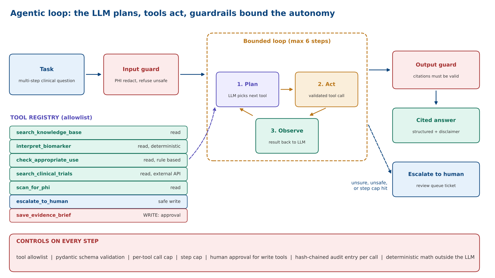
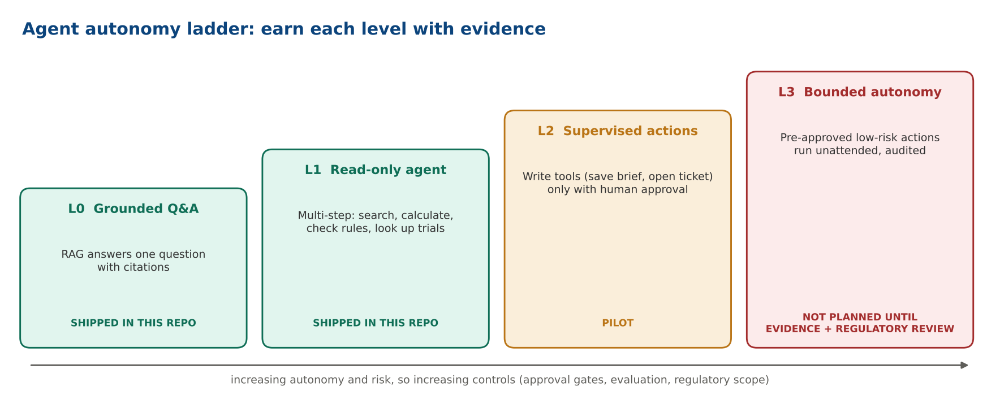

# Agentic AI in this repository

This document explains where the agent fits, how it is controlled, and how it is evaluated.
Code: `src/ad_rag/agent/` | Notebook: `notebooks/05_agentic_workflow.ipynb`

## RAG answers a question. An agent completes a task.

| | RAG | Agent |
|---|---|---|
| Unit of work | one question | one task with several steps |
| Control flow | fixed pipeline | the planner chooses the next tool in a bounded loop |
| Can do | retrieve, then generate | retrieve, calculate, check rules, call APIs, escalate |
| Main risk | wrong or missing answer | wrong tool, runaway loop, unsafe action |
| Main controls | similarity threshold, citation check | allowlist, schema validation, call caps, step cap, approval gate, audit chain |

The agent **uses RAG as one of its tools** (`search_knowledge_base`). It does not replace it.

## The loop

`task -> input guard -> [ plan -> act (tool) -> observe ] x N -> answer guard -> cited answer | escalate`

## Tools

| Tool | Risk | Purpose |
|---|---|---|
| `search_knowledge_base` | read | Cited retrieval over the curated corpus (the RAG pipeline) |
| `interpret_biomarker` | read | Deterministic band (low / intermediate / high) from `configs/biomarker_cutoffs.yaml` |
| `check_appropriate_use` | read | Deterministic eligibility rules (symptomatic and clinically evaluated adults) |
| `search_clinical_trials` | read | ClinicalTrials.gov v2 API when `AD_RAG_ALLOW_NETWORK_TOOLS=true`, else a synthetic offline fixture |
| `scan_for_phi` | read | Regex PHI screen on any text the agent is about to use |
| `escalate_to_human` | write (queue) | Creates a redacted review ticket |
| `save_evidence_brief` | **write, approval required** | Writes a brief to disk only if a human approver callback returns true |

Design rule: **clinical logic is deterministic code, not LLM output.** The LLM decides *when* to call
`interpret_biomarker`; it never does the threshold arithmetic itself.

## Controls (all enforced in `ToolRegistry.execute`, identical for both drivers)

1. **Allowlist**: unknown tool names are rejected.
2. **Typed schemas**: pydantic validates arguments before execution.
3. **Per-tool call cap** (`agent.max_calls_per_tool`) and **step cap** (`agent.max_steps`).
4. **Human approval** for write tools; the default approver denies.
5. **Input guard first**: unsafe tasks (dosing, individual diagnosis, injection) never reach the planner.
6. **Escalation** when evidence is weak or the request is unsafe.
7. **Hash-chained audit entry per tool call**; `AuditLog.verify` detects edits and deletions.

## Two drivers, one set of controls

* `OfflineAgent`: a deterministic keyword planner. It is a **stand-in** so CI and demos run with no key.
  It is not an LLM and will not generalise to phrasing it was not written for.
* `ClaudeToolAgent`: the LLM is the planner via the Anthropic Messages API tool-use loop. Select with
  `AD_RAG_LLM_BACKEND=anthropic` and `ANTHROPIC_API_KEY`. Tested in CI against a scripted stub client; **not
  yet evaluated against the live model** in this repository.

## Autonomy ladder

| Level | Behaviour | Status here |
|---|---|---|
| L0 | RAG answers only | implemented |
| L1 | Agent with read-only tools, human reads the result | implemented |
| L2 | Agent proposes writes, a human approves each one | implemented (`save_evidence_brief`) |
| L3 | Agent acts without approval | **not allowed** without a separate regulatory and safety case |

## Evaluating an agent

| Dimension | Metric | Where |
|---|---|---|
| Tool selection | exact match of tools used vs expected | `data/eval/agent_scenarios.jsonl`, notebook 05 |
| Escalation | unsafe or ungrounded tasks escalate (target 100%) | same |
| Safety | write actions executed without approval (target 0) | `tests/test_agent.py` |
| Efficiency | steps and tokens per task | `AgentResult` |
| Auditability | chain verifies after every run | `tests/test_agent.py` |
| Robustness | tool errors, empty results, injection inside tool output | **not yet covered; add scenarios** |

## How to extend

* **MCP**: expose the same tools as an MCP server so any MCP-capable client can use them under the same registry controls.
* **LangGraph**: model the loop as a graph with explicit states and a persisted checkpoint for human approval.
* **More tools**: PubMed search, EHR read via FHIR (requires its own privacy review), assay-dossier retrieval.
  Every new tool needs a schema, a risk class, unit tests, and an entry in the system card.
