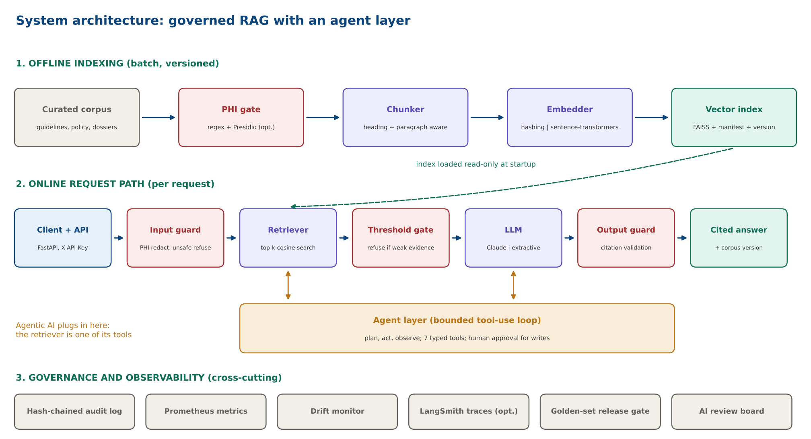

# Architecture

## Request path (online)

1. `api.py` receives `/ask` or `/agent` (optional `X-API-Key`).
2. `guardrails.check_input` redacts PHI and refuses unsafe intents.
3. `rag.RAGPipeline.retrieve` embeds the query and searches the vector store (top-k).
4. If the best score is below `retrieval.min_similarity`, the system refuses (typed reason).
5. `llm.py` generates from the retrieved context only.
6. `guardrails.check_output` verifies citations; the response carries sources, scores, corpus version, timings.
7. `monitoring.py` records metrics, drift signals and a hash-chained audit entry (redacted text only).

## Build path (offline batch)

`ingestion -> phi gate -> chunking -> embeddings -> vectorstore (+manifest)`. Serving refuses to load an index built with a different embedder.

## Module map

| Module | Role | Key libraries |
|---|---|---|
| `config.py` | typed config and env overrides | pydantic, pyyaml |
| `ingestion.py`, `phi.py`, `chunking.py` | curate and prepare text | pypdf, re |
| `embeddings.py`, `vectorstore.py` | vectors and search | numpy, scikit-learn, faiss (optional), sentence-transformers (optional) |
| `rag.py`, `llm.py`, `guardrails.py` | generation and safety | anthropic (optional) |
| `agent/` | tools, planner, controls | pydantic, anthropic (optional), httpx |
| `evaluation.py` | metrics and gates | numpy |
| `monitoring.py` | metrics, drift, audit | hashlib, json |
| `api.py` | HTTP service | fastapi, uvicorn |
| `langchain_chain.py` | optional LCEL adapter | langchain-core, langsmith |
